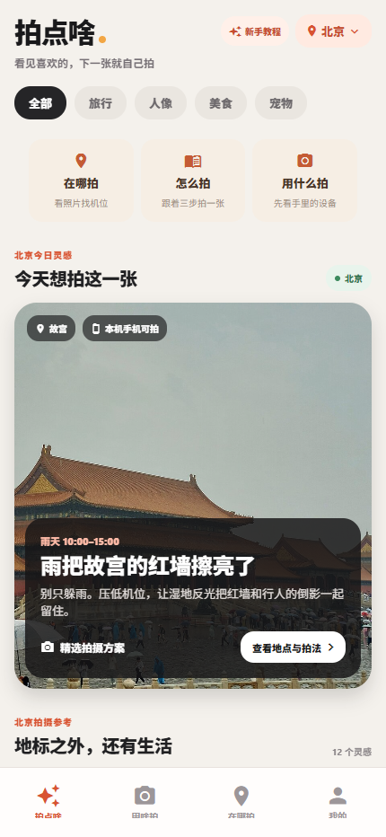
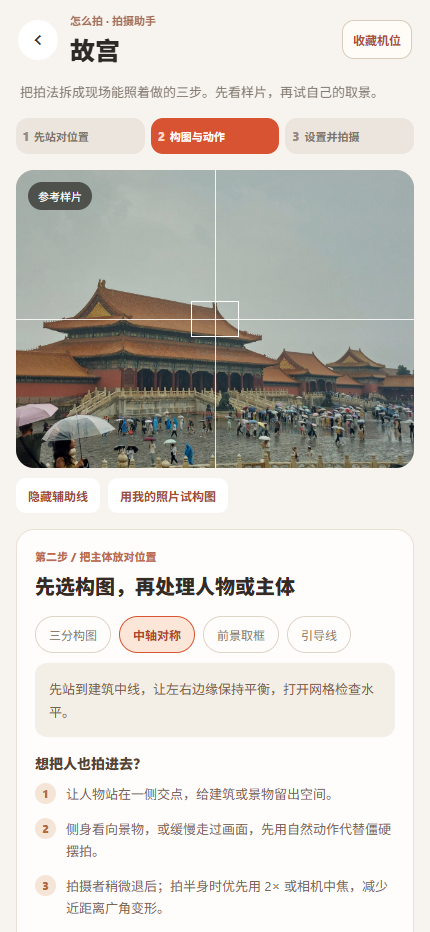
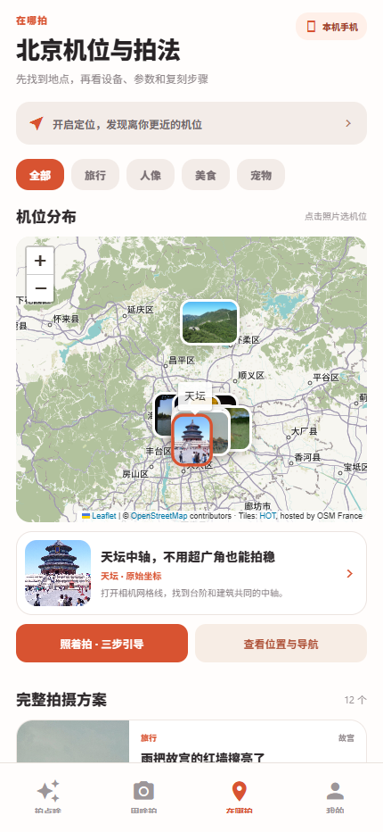

# 本地验证记录

日期：2026-10-31。环境：Windows、Chrome 无界面浏览器、Expo Web 导出。仅验证本地构建，没有向 GitHub 推送或发布，也没有创建真实测试账号或写入远端数据库。

## 已通过

- TypeScript 与 ESLint 检查：通过，无错误或警告。
- 7 项产品规则测试：坐标顺序与坐标系、真实起点与无坐标降级、手机/相机指导、夜景/运动差异、构图选择与设备兼容、浏览器照片参数转换、原始设备样片分类。
- 网页导出：通过；使用 /pds_app 路径前缀的产物可访问。
- 首页三个入口可进入地图、拍摄引导、器材页。
- 地图：9 个照片点位、6 张所需底图瓦片实际加载；点击天坛照片会切换选中地点。
- 拍摄引导：三步切换、构图辅助线、本地照片选择与样片对照、手机/相机切换、光线对应曝光建议。
- 游客收藏与发布进入真实登录页，发布来源保留；设备提问保留所选机型与拍摄场景。
- 登录空表单显示校验提示。
- 连续访问 9 条拍摄方案，没有触发旧的浏览次数登录限制。
- 深链接刷新后可直接进入拍摄引导；地图、样片和动态资源在部署前缀下可加载。
- 375px、430px 移动视口与 1440px 桌面视口可显示，375px 下无页面横向溢出。
- 上述浏览器操作未捕获到页面运行错误。

## 尚未验证

- Firebase 认证和数据库接口在当前网络中连接超时，因此真实邮箱注册、登录、密码重置、发布、问答和收藏持久化尚未验证。
- 未验证 Android/iOS 真机，未生成安装包。
- 未验证所有国内网络访问地图的表现；公共底图加载失败时保留机位列表与导航入口。
- 未发布到 GitHub Pages；当前只有本地预览。

## 界面截图

| 首页 | 拍摄引导 |
| --- | --- |
|  |  |

| 地图 | 器材场景与原始样片 |
| --- | --- |
|  |  |
